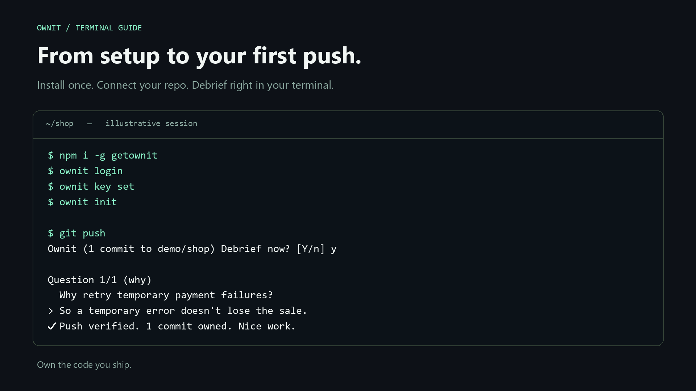
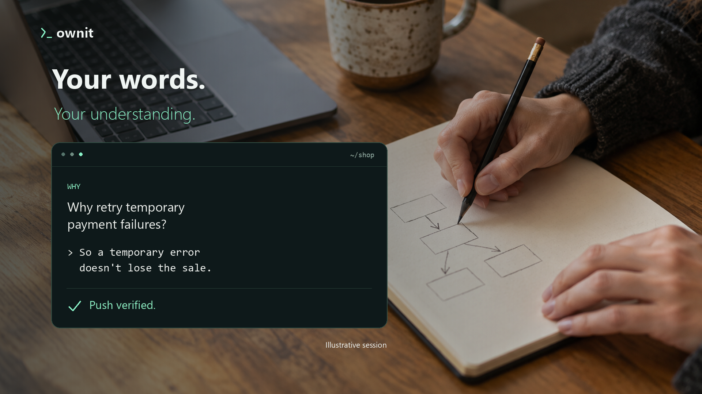

# Ownit



## Own the code you ship.

**A short debrief for the code you just pushed.** Ownit asks one to three questions about
your change, right in your terminal. Build understanding alongside your AI coding workflow.

[Watch the narrated ad](media/ownit-ad-1080p.mp4) · [Get started](#setup) · [See how it works](docs/DETAILS.md)

[](https://ownit.ownit-worker.workers.dev/Yoosseph/ownit)
[](https://github.com/Yoosseph/ownit/actions/workflows/ci.yml)
[](https://www.npmjs.com/package/getownit)
[](LICENSE)
[](https://build.nvidia.com/nvidia/nemotron-3-super-120b-a12b)
[](https://tokenfactory.nebius.com/)
[](https://workers.cloudflare.com/)
[](https://www.typescriptlang.org/)
[](https://nodejs.org/)
[](CONTRIBUTING.md)

When you run `git push`, Ownit's pre-push hook offers a debrief: why you made the change,
how it works, and what could come next. NVIDIA Nemotron (on Nebius or NVIDIA) writes the
questions and grades your answers. Debrief now or return later with `ownit interview`.

| Push | Explain | Build your record |
| --- | --- | --- |
| Use your normal Git workflow. | Answer 1–3 short questions about the change. | Passing debriefs mark commits as verified on GitHub and your repo page. |



*Illustrative terminal examples. The image uses a one-question demo; the transcript below shows a two-question push. Setup includes browser sign-in and GitHub App installation. Questions and grading vary with your change.*

```text
$ git push
Ownit (2 commits to octo/shop) Debrief now? [Y/n] y

Question 1/2 (why)
  Why does checkout now retry some failed card payments instead of failing the order right away?
> so temporary card errors dont lose the sale
✓ Passed.

Question 2/2 (how)
  How does the retry decide when to give up?
> permanent declines fail right away, temporary ones retry up to 3 times
✓ Passed.

✓ Push verified. 2 commits owned. Nice work.
```

## Why

Coding agents let you ship code faster than you can read it. Ownit makes understanding your own
code a habit: a two-minute check while the change is still fresh. Rough answers are fine. A miss
gets a hint and a new question, and you can always stop and finish later.


| Why | How | Next |
| --- | --- | --- |
| Explain the purpose of the change. | Describe the approach and how it works. | Consider a limitation, risk, or improvement. |

Small pushes get one question; larger ones get two or three. Ownit is a learning tool:
a passed debrief records understanding at the keyboard, not proof of authorship or code correctness.

## Setup

You need Node 20+, a GitHub repo and an API key from [Nebius Token Factory](https://tokenfactory.nebius.com/)
or, if you have no Nebius account, from [NVIDIA](https://build.nvidia.com/). Both serve the same Nemotron
model. `ownit key set` asks which one your key is for (or name it: `ownit key set nvidia`).

**1. Install the CLI.**

```sh
npm i -g getownit
```

**2. Sign in with GitHub.**

```sh
ownit login
```

**3. Save your API key.** Pick Nebius or NVIDIA, then paste your key at the hidden prompt. It stays on your machine.

```sh
ownit key set
```

**4. Set up your repo.** Run this inside your clone. It installs the pre-push hook and registers the repo.

```sh
cd your-repo
ownit init
```

**5. Install the Ownit GitHub App when `ownit init` asks.** If the App is not on the repo yet,
`ownit init` opens the [install page](https://github.com/apps/ownit-app/installations/new) in your
browser and waits. On that page:

1. Pick the account or organization that owns the repo.
2. Choose **Only select repositories** and select the repo (or your fork, if that is where you push).
3. Click **Install**, go back to the terminal and press Enter.

`ownit init` checks again and finishes setup. If you are not the repo's owner, send them the link and
ask them to install it for the repo; press `q` to finish later, then run `ownit init` again once it is
installed. Signing in with `ownit login` does not install the App, and there is no desktop app to download.
Until the App covers the repo, Git pushes still work but Ownit cannot record debriefs.

On Windows, use Git Bash in Windows Terminal for the interactive debrief.

## Use

Push as usual. Ownit asks before each push:

| Answer | What happens |
| --- | --- |
| **Y** or Enter | Answer the questions now. |
| **n** | Do it later with `ownit interview`. |

Your push always goes through, whatever you answer.

Each push is **verified** (all questions passed) or **pending** (not done yet). Pending commits
count as unverified, with no deadline. Run `ownit interview` whenever you like: it lists the
waiting pushes by commit message, and you pick which one to debrief. Its commits then become
verified. During a debrief, type `s` to stop and come back to it later.
GitHub shows the result as a check on the commit.

### Who owes the debrief

Once Ownit is set up on a repo, everyone who commits to it is responsible for debriefing their own
commits. If someone pushes without finishing their debrief, the repo page lists them under
**Waiting on a debrief**, with how many of their commits are still open, until they run `ownit interview`.
Each pending push also says whose debrief it is waiting on.

### Commands

| Command | What it does |
| --- | --- |
| `ownit login` | Sign in with GitHub. |
| `ownit init` | Install the pre-push hook in this repo and register it. Opens the GitHub App install page if the App is missing. |
| `ownit interview` | List your waiting pushes (including ones an AI agent made) and debrief the one you pick. |
| `ownit interview --all` | Debrief every waiting push in turn. |
| `ownit interview --range A..B` | Debrief any commit range, or `--range <sha>` for one commit. |
| `ownit key set [nebius\|nvidia]` | Save your API key. Paste it at the hidden prompt, never after the command. |
| `ownit key status` / `ownit key clear` | Show or remove the key. |
| `ownit badge` | Print this repo's badge Markdown to paste into your README. |
| `ownit settings` | Show this repo's settings and page link. |
| `ownit settings questions\|answers on\|off` | Choose what the page shows. Repo admins and maintainers only. |
| `ownit settings earlier on\|off` | Let older commits count once someone debriefs them. Admins and maintainers only. |
| `ownit whoami` | Show the server, your GitHub login, your key and its model. |
| `ownit model` | Show which provider and model your debriefs use (also `ownit plan`). Your key applies in every repo on this computer. |
| `ownit uninstall` | Remove the hook from this repo. |
| `ownit logout` | Sign out. |
| `OWNIT_SKIP=1 git push` | Push once without the prompt. The push is pending. |
| `ownit help <command>` | Details and examples for one command (same as `ownit <command> --help`). |

### Pushes from AI agents

When a coding agent (Claude Code, Cursor, Codex, CI…) pushes, nobody is at the terminal, so Ownit
records the push as **pending** and lets it through. Run `ownit interview` yourself to answer for the
change; until then its commits count as unverified.

### Where to see your record

- **GitHub:** each commit gets an **Ownit** check: verified or pending.
- **Repo page:** `https://ownit.ownit-worker.workers.dev/<owner>/<repo>` lists recent pushes, stats, and who still owes a debrief. It shows the debrief questions unless the repo's admins hide them,
  and passing answers only if they turn that on.
- **Badge:** like `Ownit | Verified 55% | Unverified 45%`, linking to the repo page. `ownit init` prints the code to paste
  into your README; `ownit badge` prints it again, and the repo page has a Copy button.

## Updating

The server updates itself; there is nothing to do for it. For the CLI:

```sh
npm install -g getownit@latest
ownit --version
```

Releases are listed on the [releases page](https://github.com/Yoosseph/ownit/releases). Your login,
key and repo setup are kept across updates.

## More

The [launch campaign](media/README.md) includes the ad video, poster, captions, terminal examples,
and source renderer.

Privacy, self-hosting, how it works and limitations: [docs/DETAILS.md](docs/DETAILS.md).
Overview of the code: [docs/ARCHITECTURE.md](docs/ARCHITECTURE.md).
Every prompt sent to the model: [prompts/](prompts/).

## Contributing

Issues and pull requests are welcome. [CONTRIBUTING.md](CONTRIBUTING.md) covers setup, tests and
what to keep true; please follow the [Code of Conduct](CODE_OF_CONDUCT.md). Report security
problems privately, as described in [SECURITY.md](SECURITY.md).

## License

[MIT](LICENSE). You can use, copy, change and redistribute Ownit, including commercially and in
closed-source projects, as long as you keep the copyright and license notice. It comes with no
warranty. Contributions are released under the same license.
