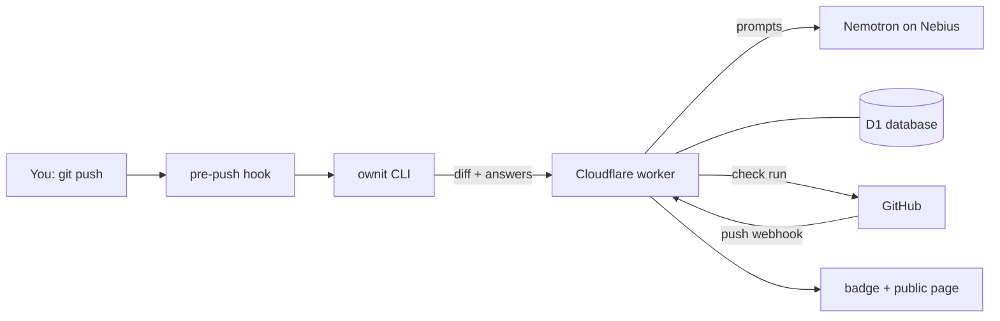

# Architecture

Ownit has three parts: a **CLI** on your machine, a **worker** on Cloudflare, and the **model** on
Nebius. GitHub tells the worker which commits actually landed.

## The parts

| Part | Where | What it does |
| --- | --- | --- |
| CLI | `cli/` | Installs the pre-push hook, builds the diff, asks you the questions, sends your answers. |
| Worker | `worker/` | Writes and grades questions with the model, records pushes, talks to GitHub. |
| Database | Cloudflare D1 (`worker/migrations/`) | Repos, users, pushes, commit SHAs, question text and pass/fail. No code, no answers. |
| Model | Nebius Token Factory | `nvidia/nemotron-3-super-120b-a12b`, paid with your own key. |
| GitHub App | `ownit-app` | Sends push webhooks and shows the **Ownit** check run on each commit. |

## What happens on a push

1. **You push.** The pre-push hook asks: debrief now? (`Y` / `n` / `s`). It never blocks the push.
2. **The CLI builds the diff** locally, drops lockfiles, build output and anything in
   `.ownitignore`, and sends it with the commit messages to the worker.
3. **The worker asks the model for 1–3 questions** (more for bigger pushes): *why*, *how*, *next*.
   Each question has a reference answer, which is encrypted into a token the CLI carries but can't read.
4. **You answer in the terminal.** The worker has the model grade each answer. If it misses, you get
   feedback and a follow-up question. When every question passes, the push is **verified**.
5. **GitHub sends a push webhook.** The worker matches the landed commits by SHA and sets the check
   run. Commits that arrived with no debrief become a **pending** push.
6. **Every hour a cron job** turns pending pushes older than 24 hours into **skipped**.

Missed the prompt? Run `ownit interview` later to debrief pending pushes.

## Push statuses

| Status | Meaning |
| --- | --- |
| verified | All questions passed. |
| skipped | You pressed `s`, or it sat pending for 24 hours. |
| pending | No debrief yet. |
| provider_error | The model call failed (bad key, no credit, outage). Retry with `ownit interview`. |

The badge shows the share of commits that were verified rather than skipped.

## Login

`ownit login` runs GitHub's device flow. The worker checks who you are, throws away the GitHub
token and gives the CLI its own `ownit_…` session token. Every `/api/*` call needs it, and the
worker checks that you have push access to the repo.

## Worker routes

| Route | Used by |
| --- | --- |
| `/auth/*` | `ownit login` / `logout` |
| `/api/repos` | `ownit init` (registers the repo) |
| `/api/pushes` | The hook (records a pending or skipped push) |
| `/api/interview/start`, `/answer`, `/skip` | The debrief itself |
| `/webhooks/github` | GitHub push events |
| `/:owner/:repo`, `/badge/...` | Public page and badge |

## Running your own copy

Anyone can host Ownit (see "Self-hosting" in the README). A copy is fully separate: its own worker,
database and GitHub App, with no access to the official server's data. The CLI talks to the
official server (`ownit.ownit-worker.workers.dev`) unless you pass `ownit login --server <url>`.
Badges link to the server that made them, and the public page names the official server, so a
badge from a copy is easy to spot.

## Where to look in the code

- CLI commands: `cli/src/commands/`; the hook script: `cli/src/hooks.ts`
- Debrief flow: `worker/src/routes/interview.ts`; prompts: `worker/src/prompts.ts`
- Webhook: `worker/src/routes/webhook.ts`; check runs: `worker/src/checks.ts`
- Hourly expiry: `worker/src/cron.ts`

More detail: [README](../README.md) (privacy, prompt-injection design), [SPEC](SPEC.md),
[HANDOFF](HANDOFF.md).
