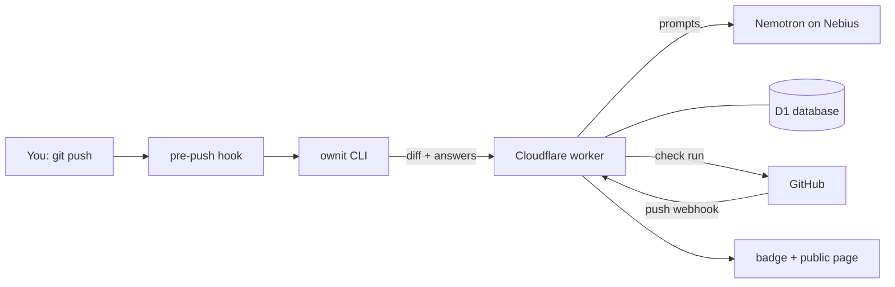

# Architecture

Ownit has three parts: a **CLI** on your machine, a **worker** on Cloudflare, and the **model** on
Nebius. GitHub tells the worker which commits actually landed.

## The parts

| Part | Where | What it does |
| --- | --- | --- |
| CLI | `cli/` | Installs the pre-push hook, builds the diff, asks you the questions, sends your answers. |
| Worker | `worker/` | Writes and grades questions with the model, records pushes, talks to GitHub. |
| Database | Cloudflare D1 (`worker/migrations/`) | Repos (with settings), users, pushes, commit SHAs, question text and pass/fail. No code. Answers only where a public repo shows them. |
| Model | Nebius Token Factory or NVIDIA's API, whichever your key is for | `nvidia/nemotron-3-super-120b-a12b`, paid with your own key. |
| GitHub App | `ownit-app` | Sends push webhooks and shows the **Ownit** check run on each commit. |

## What happens on a push

1. **You push.** The pre-push hook asks: debrief now? (`Y` / `n`). It never blocks the push.
2. **The CLI builds the diff** locally, drops lockfiles, build output and anything in
   `.ownitignore`, and sends it with the commit messages to the worker.
3. **The worker asks the model for 1–3 questions** (more for bigger pushes): *why*, *how*, *next*.
   Each question has a reference answer, which is encrypted into a token the CLI carries but can't read.
4. **You answer in the terminal.** The worker has the model grade each answer. If it misses, you get
   feedback and a follow-up question. On a follow-up, you may instead stand by the answer that missed
   (once per debrief, no model call); that question passes and shows as **disputed** on the page and
   check run. When every question passes, the push is **verified**.
5. **GitHub sends a push webhook.** The worker matches the landed commits by SHA and sets the check
   run. Commits that arrived with no debrief become a **pending** push. Merge commits made by
   GitHub's Merge or Update branch button (committer `web-flow`) are left out.
6. **Nothing expires.** A pending or skipped push stays unverified until you debrief it with
   `ownit interview`, whenever that is.

Missed the prompt? Run `ownit interview` later to debrief pending pushes.

## Push statuses

| Status | Meaning |
| --- | --- |
| verified | All questions passed. |
| skipped | Only from CLIs before 0.1.2. Treated like pending. |
| pending | No debrief yet. |
| provider_error | The model call failed (bad key, no credit, outage). Retry with `ownit interview`. |

The badge shows the share of tracked commits that are verified, and the rest as unverified:
`Ownit | Verified 55% | Unverified 45%`.

## Login

`ownit login` runs GitHub's device flow. The worker checks who you are, throws away the GitHub
token and gives the CLI its own `ownit_…` session token. Every `/api/*` call needs it, and the
worker checks that you have push access to the repo.

## Worker routes

| Route | Used by |
| --- | --- |
| `/auth/*` | `ownit login` / `logout` |
| `/api/repos` | `ownit init` (registers the repo) |
| `/api/repos/settings` | `ownit settings` (page visibility and earlier commits; changing needs admin or maintain) |
| `/api/pushes` | The hook (records a pending push) |
| `/api/interview/start`, `/answer`, `/skip` | The debrief itself (`/skip` only for older CLIs) |
| `/webhooks/github` | GitHub push events |
| `/:owner/:repo`, `/badge/...` | Public page and badge |

## Running your own copy

Anyone can host Ownit (see "Self-hosting" in [DETAILS](DETAILS.md#self-hosting)). A copy is fully separate: its own worker,
database and GitHub App, with no access to the official server's data. The CLI talks to the
official server (`ownit.ownit-worker.workers.dev`) unless you pass `ownit login --server <url>`.
Badges link to the server that made them, and the public page names the official server, so a
badge from a copy is easy to spot.

## Where to look in the code

**CLI** (`cli/src/`)

- `index.ts`: the command table, with each command's help lines. One file per command in `commands/`;
  `commands/hook.ts` runs on every push.
- `debrief.ts` asks the questions, `diff.ts` builds the filtered diff, `hooks.ts` writes the git hook.
- `providers.ts`: the model providers a key can be for. `config.ts`: `~/.ownit/config.json`.

**Worker** (`worker/src/`)

- `routes/`: one router per URL prefix, sharing helpers through `routes/shared.ts`. The debrief
  itself is `routes/interview.ts`; GitHub push events are `routes/webhook.ts`.
- `db.ts`: every query on repos, users, pushes, commits and questions.
- `debrief.ts` and `prompts.ts`: the three model calls. The prompt text is in [`/prompts`](../prompts/).
- `model.ts`: the providers and their clients. `fixtureModel.ts`: the offline model for tests.
- `sessions.ts` (who is calling) and `access.ts` (may they push to this repo, or change its
  page settings as an admin or maintainer).
- `checks.ts` (GitHub check runs), `page.ts` and `badge.ts` (public page
  and badge), `links.ts` (public URLs).

More detail: [DETAILS](DETAILS.md) (privacy, prompt-injection design), [SPEC](SPEC.md),
[HANDOFF](HANDOFF.md).
