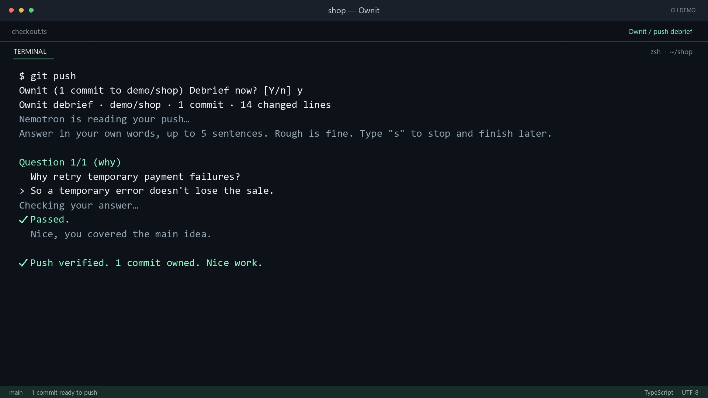

# Ownit launch film

[Watch the narrated ad](ownit-ad-1080p.mp4) · [Poster](ownit-ad-poster.jpg) · [Captions](ownit-ad.srt) · [Voiceover](source/narration.mp3)



A 22.5-second terminal-only product demo with a brief, smooth male narrator. It opens
on a commit summary, then types `git push`; Ownit's prompt appears at three seconds.
One terminal session follows a question, typed answer, and verified result. Quiet original
music sits under the narration. The closing installation command appears over the terminal.
There are no people, photographs, or laptop shots.

The export is 1920 × 1080, 16:9, 30 fps, H.264 with AAC stereo audio and `faststart`.
The mix targets -16 LUFS with a -1 dBTP ceiling. Captions follow the spoken words.

## Sequence

| Time | Picture |
| --- | --- |
| 0–1.75s | Terminal shows the example commit summary. |
| 1.75–3.7s | `git push`, then the Ownit prompt; the same terminal stays in view. |
| 3.7–8s | Captured CLI output introduces the debrief and its question. |
| 8–15s | An answer is typed, checked, and marked verified. |
| 15–18.5s | The result holds while the narrator says, “Explain it. Own it.” |
| 18.5–22.5s | “Own the code you ship,” installation command, and repository URL. |

## Demo provenance

The debrief output comes from executing the project's actual `runDebrief` function with
controlled offline API responses. The question, answer, and passing grade are demo fixtures,
not a live model evaluation or a real remote push. The commit summary, typing, and initial push prompt are staged by the renderer. A verified debrief does not prove authorship
or code correctness.

- [capture_cli_demo.mjs](source/capture_cli_demo.mjs): runs the real CLI debrief with fixture responses.
- [cli-demo.json](source/cli-demo.json): captured output events, timing, and editor snippet.
- [cli-demo.txt](source/cli-demo.txt): readable captured terminal output.
- [render_ad.py](source/render_ad.py): terminal examples, animation, music, mix, and export.
- [story.json](source/story.json): narration script and minimum segment durations.
- [timeline.json](source/timeline.json): narration boundaries and word timing.
- [narration.mp3](source/narration.mp3): committed voice track for offline rendering.
- [generate_narration.py](source/generate_narration.py): optional voice regeneration.

The README artwork is rendered directly from text by the same script: setup and first
push, the captured debrief, and returning later with `ownit interview`. These are illustrative
examples, not screenshots of a live remote push. The setup card abbreviates interactive
steps; follow the README setup instructions for GitHub sign-in and App installation.
Historical image prompts and the unused laptop plate remain in source assets but are not
used by the README or video renderer.

The voice is AI-generated with Microsoft's `en-US-AndrewNeural` voice at `-8%` rate and `-2Hz`
pitch through [edge-tts](https://github.com/rany2/edge-tts). The script spells “Own it” for
pronunciation; captions display “Ownit.” No person's voice was cloned. The original score uses
synthesized tones, with no external recordings or samples.

## Re-render offline

Use Python 3.10+:

```sh
python -m pip install -r media/source/requirements.txt
python media/source/render_ad.py
```

The renderer uses the committed CLI capture, voice track, and timeline without
network requests. Pass `--ffmpeg /path/to/ffmpeg` to use your own encoder; otherwise it uses
`imageio-ffmpeg`. Fonts are Segoe UI and Consolas on Windows, with DejaVu fallbacks on Linux.
Review line widths after font substitutions. `--stills-only` exports the poster, all three README terminal
images, captions, and previews. Intermediate files go into ignored `.tmp/`.
Every completed export is decoded in full to check both audio and video streams.

To refresh the CLI capture from source, use Node 24+:

```sh
node media/source/capture_cli_demo.mjs
```

This uses Node's built-in TypeScript transformation, with no package installation or network
calls. It supplies offline API responses and does not read credentials or push commits.

## Change the narration

Edit `source/story.json`, then run:

```sh
python -m pip install -r media/source/requirements-voice.txt
python media/source/generate_narration.py
python media/source/render_ad.py
```

Voice generation sends the public narration script to the speech service and requires network
access. It updates the voice track and timeline. Review terminal timing and captions whenever
the script or delivery rate changes.
